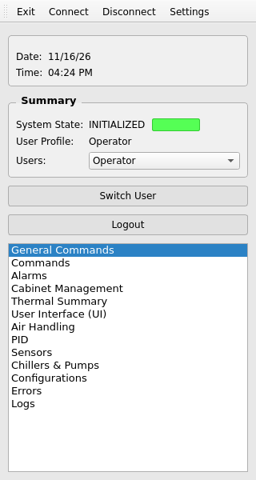

.. _User_Guide:

################
User Guide
################

This graphical user interface (GUI) is a Qt-based application to monitor and control the Dynalene system.
It is under development: the main window and the list of windows are available, but the communication with the Dynalene controller is not implemented yet.

.. _Operation:

Operation
=========

Use the command line in terminal to run the GUI:

.. code:: bash

    run_dynalenegui

.. _lsst.ts.dynalenegui-user_main_window:

Main Window
===========

  Main window of the application.

From top to bottom, the main window shows:

* **Tool bar**: the actions of the application (see :ref:`lsst.ts.dynalenegui-user_tool_bar`).
* **Date and time**: the current date and time of the computer.
* **Summary**: the system state and the current user profile.
* **Switch User** and **Logout** buttons (see :ref:`lsst.ts.dynalenegui-user_profiles`).
* **List of windows**: double-click an item to open its window (see :ref:`lsst.ts.dynalenegui-user_windows`).

Note: The system state is a placeholder until the communication with the controller is implemented.

.. _lsst.ts.dynalenegui-user_tool_bar:

Tool Bar
--------

* **Exit**: asks for confirmation and closes the application.
* **Connect**: connects to the Dynalene controller (not implemented yet).
* **Disconnect**: disconnects from the Dynalene controller (not implemented yet).
* **Settings**: shows the application settings (not implemented yet).

.. _lsst.ts.dynalenegui-user_profiles:

User Profiles
-------------

The available profiles are *Operator*, *Engineer* and *Admin*.
Select a profile in **Users** and click **Switch User** to change the **User Profile**.
The profiles do not change the permissions of the user yet, and **Logout** is not implemented yet.

.. _lsst.ts.dynalenegui-user_windows:

Windows
=======

Double-click an item of the list in the main window to open its window.
If the window is already open, it is brought to the front.
The windows are empty for now; their content will be added in future versions.

* General Commands
* Commands
* Alarms
* Cabinet Management
* Thermal Summary
* User Interface (UI)
* Air Handling
* PID
* Sensors
* Chillers & Pumps
* Configurations
* Errors
* Logs
